  

  Computer Science engineering student at <strong>UM6P College of Computing</strong>. 
  I build and study dependable systems across infrastructure, cybersecurity, simulation, and robotics.

  <a href="https://iboutbaoucht.github.io/">Portfolio &amp; résumé</a>
  &nbsp;·&nbsp;
  <a href="https://www.linkedin.com/in/imad-boutbaoucht/">LinkedIn</a>

---

## Selected systems

| Project | What it demonstrates |
|---|---|
| **[VMaaS Zero-Touch](https://github.com/IBoutbaoucht/vmaas-zerotouch)** | Go service for zero-touch Ubuntu VM provisioning and lifecycle automation on standalone VMware ESXi. |
| **[Iron Bird](https://github.com/IBoutbaoucht/iron-bird)** | Author-built, eight-stage ESP32 security challenge using a custom UDP protocol and browser progression map. |
| **[Aero Simulator 2D](https://github.com/IBoutbaoucht/aero-simulator-2d)** | Deterministic flight-control laboratory with RK4 integration, cascaded PID control, and scripted disturbances. |
| **[GitHop](https://github.com/IBoutbaoucht/GitHop)** | Full-stack GitHub discovery prototype using TypeScript, React, PostgreSQL, pgvector, and background ingestion. |
| **[Information Security Labs](https://github.com/IBoutbaoucht/info-sec-labs)** | Reproducible study material for web security, cryptography, fingerprinting, and defensive analysis. |
| **[Blablo Fruits](https://github.com/IBoutbaoucht/blablo-fruits)** | Crop-condition recognition prototype combining object detection and image classification. |

## Current work

- **ARCAD** — research platform for network-aware multi-UAV simulation.
- **PHANTOM** — autonomous ground-vehicle prototype developed with the Forgebots Robotics Club.
- **Security engineering** — practical web-security labs, Capture the Flag work, networking, and secure-systems study.

## Working principles

I value systems that can be inspected, reproduced, tested, and explained. Public projects include their real status and constraints; academic, club, research, and independent work are identified as such.

  Rabat, Morocco · Open to internships, research collaboration, and well-scoped engineering work

